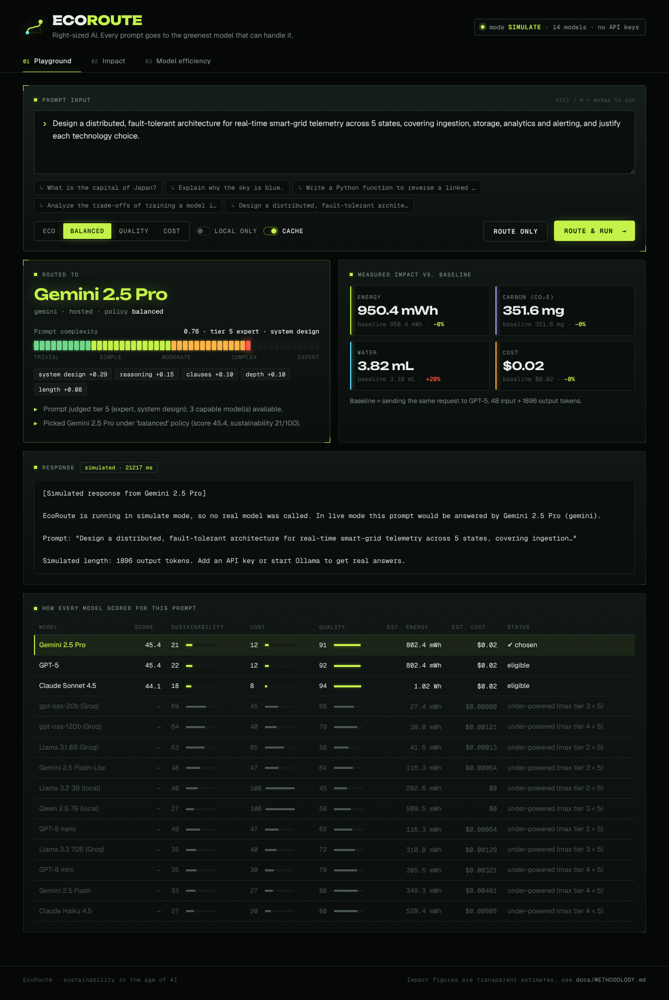
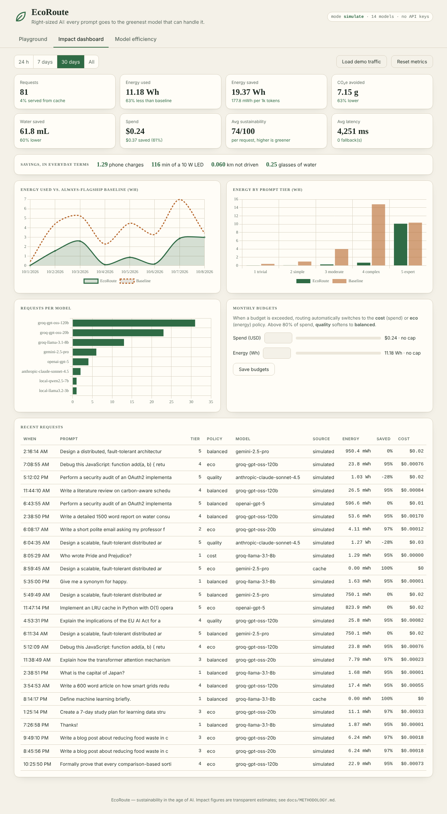
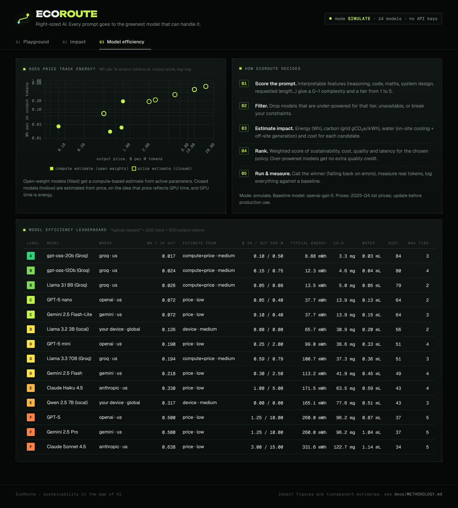

# EcoRoute 🌱 — Sustainability in the age of AI

**An energy-aware router for large language models.** EcoRoute reads each prompt, judges how hard it
is, and sends it to the *greenest model that can still answer it well* — a small open model for
"what's the capital of Japan?", a frontier model only for "design a fault-tolerant smart-grid
architecture". It estimates the energy, carbon, water and money of every call, logs it against an
"always use the flagship" baseline, and shows the savings on a live dashboard.



## Why

AI inference runs in data centres that draw a growing share of the world's electricity and consume
large volumes of fresh water for cooling. Most applications send *every* request to one large model,
even though a large fraction of real prompts are simple. Right-sizing the model per prompt is one of
the cheapest efficiency wins available: same answers, a fraction of the compute.

On the bundled 66-prompt benchmark (simulate mode, estimates), routing cuts energy and carbon by
**~66%** and cost by **~65%** versus always using GPT-5 — see [benchmarks/RESULTS.md](benchmarks/RESULTS.md).

## Features

| | |
|---|---|
| **Complexity analysis** | Interpretable 0–1 score and 5 tiers (trivial → expert) from reasoning, code, maths, system-design, domain and length signals; every contribution is shown. |
| **Sustainability scoring** | Per-model energy (Wh/1k tokens) from active parameters, **token price as an energy proxy** for closed models, or measured device power for local models; carbon from grid intensity; water from on-site cooling + off-site generation. A–G efficiency labels. |
| **Policies** | `eco`, `balanced`, `quality`, `cost` — weighted ranking of sustainability, cost, quality and latency. |
| **Local models** | Ollama models are routed to when available; `require_local` keeps data on-device. |
| **Carbon-aware** | Optional live grid carbon intensity from Electricity Maps. |
| **Cost & efficiency management** | Per-request cost/energy caps, monthly spend & energy budgets that automatically shift policy, a response cache that also matches reworded questions (cache hits cost ~0), concise mode, fallback chain on provider errors. |
| **Carbon-aware batches** | Queue non-urgent work with a deadline; it runs when the live grid is cleaner than usual, or at the deadline. |
| **Sustainability reports** | Monthly report as JSON, CSV or a printable page (save as PDF): footprint with low–high ranges, savings, per model and per team, quality evidence and methodology. |
| **Metrics** | SQLite ledger of every request: tokens, latency, Wh, gCO₂e, mL water, $, baseline counterfactual, sustainability score; summaries, time series and everyday equivalents. |
| **Interfaces** | Web dashboard, REST API, **OpenAI-compatible** `/v1/chat/completions` endpoint (drop-in, with streaming and tool calling), CLI. |
| **Quality safeguards** | Shadow evaluations grade routed answers against the baseline with a blind LLM judge; cascade mode re-asks a stronger model when an answer clearly fails; 👍/👎 feedback re-asks on demand and steers future routing away from models users dislike. |
| **Eco receipt** | A drop-in script (`/static/receipt.js`) that shows end users which model answered and what it saved, built for AI products that embed EcoRoute. |
| **Teams & access** | Optional API keys mapped to teams; every request is attributed, and a team key only sees its own metrics. |
| **Runs without keys** | Simulate mode exercises the full pipeline with no API keys — ideal for demos. |

Providers: OpenAI, Anthropic, Google Gemini, Mistral, DeepSeek, xAI, Groq (open-weight models) and
Ollama (local), plus any OpenAI-compatible endpoint with a few lines in `ecoroute/providers/__init__.py`.
The bundled catalog covers **79 models**: every current text model each provider lists, with
prices checked 2026-10-11 against the pricing pages linked in `ecoroute/data/catalog.yaml`.

## Quick start

```bash
git clone https://github.com/harshh-2505/ecoroute.git
cd ecoroute
python -m venv .venv && source .venv/bin/activate     # Windows: .venv\Scripts\activate
pip install -e ".[dev]"

cp .env.example .env            # optional: add API keys; without any, EcoRoute simulates
ecoroute serve                  # → http://127.0.0.1:8000
```

Open the dashboard, try the example prompts in the **Playground**, then click **Load demo traffic**
on the **Impact dashboard** to populate the charts.

### Using real models

Add any of these to `.env` — EcoRoute only routes to providers it can actually reach:

```bash
GROQ_API_KEY=...        # cheapest way to try open-weight models (Llama, gpt-oss)
GEMINI_API_KEY=...
OPENAI_API_KEY=...
ANTHROPIC_API_KEY=...
MISTRAL_API_KEY=...
DEEPSEEK_API_KEY=...
XAI_API_KEY=...
```

Local models: install [Ollama](https://ollama.com), then `ollama pull llama3.2:3b` and
`ollama pull qwen2.5:7b`. They are detected automatically.

### CLI

```bash
ecoroute route "Explain why the sky is blue"          # decision only, no model call
ecoroute chat  "Write a haiku about solar panels" --policy eco
ecoroute chat  "Summarise my notes" --local           # never leaves your machine
ecoroute models                                       # efficiency leaderboard
ecoroute bench                                        # reproduce benchmarks/RESULTS.md
```

### As a drop-in OpenAI endpoint

```python
from openai import OpenAI
client = OpenAI(base_url="http://127.0.0.1:8000/v1", api_key="unused")
r = client.chat.completions.create(
    model="ecoroute/eco",            # or ecoroute/auto | balanced | quality | cost | <catalog id>
    messages=[{"role": "user", "content": "What is a heat pump?"}],
)
print(r.choices[0].message.content, r.model)   # r.model = the model EcoRoute picked
```

The response also carries an `ecoroute` field with the measured impact and savings.

The endpoint supports what real apps send:

* **Streaming** (`stream=True`): native token streaming from OpenAI-compatible providers, Anthropic,
  Gemini and Ollama. The final chunk carries `usage` and the `ecoroute` impact block. If a provider
  fails before its first token, EcoRoute falls back to the next model silently.
* **Tool / function calling** (`tools`, `tool_choice`, `tool` role messages): translated to each
  provider's format (Anthropic `tool_use`, Gemini `functionCall`, Ollama tools). Requests with tools
  are routed only to tool-capable models of tier 2 or above, and are never cached.
* `temperature`, `top_p`, `stop`; multi-part `content` arrays (text parts are used).

### Sustainability reports

`GET /v1/report?month=2026-10&format=html` gives a printable monthly report (the page has a Save as PDF
button); `format=csv` gives one row per model plus a total, and `format=json` the raw numbers. Every
figure comes with a low–high range from the uncertainty of its estimation method (×/÷1.5 for measured
device power, ×/÷1.6 for compute-based estimates, ×/÷2.5 for price-based estimates of closed models).
Add `team=` for one team's report; a team key always gets its own.

### Carbon-aware batches

```bash
curl -X POST localhost:8000/v1/batch -H 'content-type: application/json' -d '{
  "deadline_hours": 12,
  "requests": [{"custom_id": "doc-1", "prompt": "Summarise this report: …"},
               {"custom_id": "doc-2", "prompt": "Tag these tickets: …"}]}'
# → {"id": "batch_…", "status": "queued", …}       GET /v1/batch/{id} for status and answers
```

Batch items run when live grid data (`ELECTRICITYMAPS_API_KEY`) shows the serving region at or below
85% of its average carbon intensity (or `max_carbon_g_per_kwh`), and in any case within the hour
before the deadline. Something has to call `GET /v1/batch-run` regularly: a cron job, or Vercel Cron
with `CRON_SECRET` set (EcoRoute accepts `Authorization: Bearer $CRON_SECRET`). `?force=true` runs
everything now.

### Concise mode and the smarter cache

`"concise": true` in `constraints` (or `ECOROUTE_CONCISE=true`) asks the model to answer briefly and
caps output at 1.2× the tier's expected length. Output tokens are most of the energy of a call.

The cache matches the same question asked in different words: case, punctuation, articles, contractions
and polite filler are ignored, so "What's the capital of France?" and "please tell me what is the
capital of france" share one entry. Prompts containing code or maths symbols only ignore case and
spacing, because a single symbol can change their meaning.

### Quality safeguards

Right-sizing only matters if answers stay good. EcoRoute gives you three ways to check and protect that:

* **Shadow evaluations** (`ECOROUTE_SHADOW_RATE=0.05`): for a sample of live requests, the same
  prompt also goes to the baseline model, and a judge model (`ECOROUTE_JUDGE_MODEL`, default the
  baseline) grades both answers without knowing which is which. `GET /v1/quality` reports the share
  of routed answers judged as good as or better than the baseline, by tier, plus the energy and cost
  the evaluations themselves used (kept out of the savings figures). `POST /v1/quality/eval/{id}`
  grades one earlier request on demand.
* **Cascade** (`ECOROUTE_CASCADE=true`, or `"cascade": true` in `constraints`): each answer gets a
  cheap check for clear failures (empty, cut off, refusal, far too short, no code for a coding task).
  If it fails, the next stronger eligible model answers instead. Both attempts stay on the ledger, so
  the extra energy is counted. Not applied to streamed or simulated answers.
* **Feedback** (`POST /v1/feedback {"request_id": 12, "rating": "down", "escalate": true}`): a 👎
  with `escalate` re-asks a stronger model (one tier up, excluding the first model) and returns its
  answer. After three or more votes, a model's thumbs-down rate lowers its quality score in routing,
  and the decision says so.

Full prompts and answers are kept for 7 days (only when `ECOROUTE_STORE_PROMPTS` is on) so that
feedback and evaluations can use them.

### Eco receipt for your product

```html
<script src="https://your-ecoroute-host/static/receipt.js"></script>
<div id="receipt"></div>
<script>EcoReceipt.render("#receipt", completion);  // any EcoRoute response, or its `ecoroute` block</script>
```

The badge shows the model, energy, CO₂e, water and the saving against the baseline. It renders in a
shadow root, follows light or dark mode (`theme: "auto" | "dark" | "light"`), and has a one-line
`compact` form. Elements with a `data-ecoroute='…json…'` attribute are filled in automatically. The
dashboard's **Embed** tab shows a live preview.

### Access keys and teams

```bash
ECOROUTE_API_KEYS="sk-eco-search:search, sk-eco-support:support"   # key:team pairs
ECOROUTE_ADMIN_KEY="sk-eco-admin"                                   # reset, budgets, demo seeding
```

With keys set, every `/v1/*` call needs `Authorization: Bearer <key>` (or `X-API-Key`). Requests are
logged against the key's team, `/v1/metrics/*` accept `?team=`, and a team key only sees its own
team's numbers. A key without a team can name one per request with `X-EcoRoute-Team`. With no keys
configured, EcoRoute stays open, which suits local use and demos.

## API

| Method | Path | Purpose |
|---|---|---|
| `POST` | `/v1/analyze` | Complexity score and feature breakdown |
| `POST` | `/v1/route` | Routing decision with every candidate's scores (no model call) |
| `POST` | `/v1/chat` | Route, execute, measure, log |
| `POST` | `/v1/chat/completions` | OpenAI-compatible |
| `GET` | `/v1/models` | Catalog with efficiency labels and typical-request impact |
| `GET` | `/v1/grid` | Grid regions and (live) carbon intensity |
| `GET` | `/v1/metrics/summary?days=30` | Totals, savings vs baseline, by model / tier / task, equivalents |
| `GET` | `/v1/metrics/timeseries?days=7&bucket=hour` | Energy, carbon, water, cost over time |
| `GET` | `/v1/metrics/requests` | Recent request log |
| `GET/PUT` | `/v1/budget` | Monthly spend and energy budgets |
| `GET` | `/v1/report?month=&format=json\|csv\|html` | Monthly sustainability report |
| `POST` | `/v1/batch` · `GET /v1/batch/{id}` | Carbon-aware batch queue |
| `GET/POST` | `/v1/batch-run` | Run due batch items (for a scheduler) |
| `POST` | `/v1/feedback` | 👍/👎 on an answer, optionally re-asking a stronger model |
| `GET` | `/v1/quality` | Shadow-evaluation parity, feedback and escalation stats |
| `POST` | `/v1/quality/eval/{id}` | Grade one earlier live answer against the baseline |
| `POST` | `/v1/demo/seed` | Fill the dashboard with demo traffic (simulate mode only) |

Interactive docs at `/docs`. Request options for `/v1/route` and `/v1/chat`:

```json
{
  "prompt": "…",                     // or "messages": [{"role": "user", "content": "…"}]
  "policy": "eco",
  "constraints": {
    "max_cost_usd": 0.001, "max_energy_wh": 0.05,
    "require_local": false, "prefer_local": true,
    "allowed_providers": ["groq", "ollama"], "exclude_models": [],
    "min_tier": 3, "force_model": null
  }
}
```

## How it works

```
prompt ─▶ complexity analyser ─▶ tier 1–5 + expected tokens
                                     │
model catalog ─▶ impact estimator ─▶ Wh · gCO₂e · mL · $ per candidate
                                     │
             policy + constraints + budget ─▶ router ─▶ ranked candidates
                                                          │
                     cache ◀──▶ provider (with fallback chain) ─▶ real token usage
                                                          │
                                         ledger (vs baseline) ─▶ dashboard / API
```

The full model — formulas, constants, calibration, evaluation and limitations — is in
**[docs/METHODOLOGY.md](docs/METHODOLOGY.md)**. In short:

* **Open-weight models:** `Wh/1k ≈ 2 · active_params · 1000 / 2e11 FLOP/J / 3600 × PUE`
* **Closed models:** price as an energy proxy, `Wh/1k ≈ 0.5 × (price_out / $10)^0.6`
* **Local models:** `Wh/1k = device_watts / tokens_per_sec × 1000 / 3600`
* **Carbon** = kWh × grid intensity; **water** = on-site cooling (WUE) + off-site generation



One finding worth calling out: per token, a laptop running a small local model can use *more*
energy than a large shared data centre, because the data centre batches many users per GPU. Local
inference still wins on cost, cooling water, privacy and offline use — EcoRoute shows the trade-off
rather than assuming it.



## Configuration

| Variable | Default | |
|---|---|---|
| `ECOROUTE_MODE` | `auto` | `simulate`, `live`, or `auto` (live if any provider is reachable) |
| `ECOROUTE_POLICY` | `balanced` | default policy |
| `ECOROUTE_BASELINE_MODEL` | `openai-gpt-5` | counterfactual for savings |
| `ECOROUTE_LOCAL_REGION` | `global` | grid region of your machine (`india`, `eu`, `us`, `nordics`, `france`, `china`) |
| `ECOROUTE_MONTHLY_BUDGET_USD` / `_ENERGY_BUDGET_WH` | `0` (off) | budgets (also editable in the dashboard) |
| `ECOROUTE_CACHE`, `ECOROUTE_CACHE_TTL_HOURS` | `true`, `24` | response cache |
| `ECOROUTE_STORE_PROMPTS` | `true` | store the first 120 chars of prompts in the log |
| `ECOROUTE_DB` | `ecoroute.db` | SQLite file |
| `ECOROUTE_CATALOG`, `ECOROUTE_GRID` | bundled YAML | your own model catalog / grid data |
| `ELECTRICITYMAPS_API_KEY` | — | live carbon intensity |
| `OLLAMA_HOST` | `http://localhost:11434` | local models |
| `ECOROUTE_API_KEYS` | — | `key:team` pairs; turns on authentication |
| `ECOROUTE_ADMIN_KEY` | — | key for reset, budget changes and demo seeding |
| `ECOROUTE_CONCISE` | `false` | concise mode by default |
| `CRON_SECRET` | — | lets a scheduler call `/v1/batch-run` |
| `ECOROUTE_CASCADE` | `false` | check answers and escalate clear failures |
| `ECOROUTE_SHADOW_RATE` | `0` | share of live requests graded against the baseline (costs extra calls) |
| `ECOROUTE_JUDGE_MODEL` | baseline | catalog id of the judge model |

Model prices in `ecoroute/data/catalog.yaml` are a snapshot — check providers' pricing pages and
update them (and add new models) before relying on cost figures.

## Docker

```bash
docker build -t ecoroute .
docker run -p 8000:8000 --env-file .env ecoroute
```

## Deploy on Vercel

[](https://vercel.com/new/clone?repository-url=https://github.com/harshh-2505/ecoroute)

`app.py` exposes the FastAPI app, so Vercel detects it with no build settings (Framework Preset:
FastAPI, or Other). With no keys it runs in simulate mode; add provider keys from `.env.example` as
Vercel environment variables to route to real models. The request ledger is SQLite in `/tmp`, so
dashboard data resets when the function cold-starts; use **Load demo traffic** to repopulate it.

## Development

```bash
pytest            # all tests run offline, no network needed
ruff check .
python -m benchmarks.run_benchmark
```

```
ecoroute/
  complexity.py   prompt analyser
  impact.py       energy / carbon / water / cost model
  router.py       policies, constraints, ranking
  service.py      orchestration: route → cache → execute → measure → log
  providers/      OpenAI, Anthropic, Gemini, Mistral, DeepSeek, xAI, Groq, Ollama, simulator
  ledger.py       SQLite metrics, cache, budgets
  api.py          FastAPI app
  cli.py          command-line interface
  data/           model catalog, grid regions, demo prompts
  static/         dashboard
benchmarks/       labelled prompts + benchmark runner
docs/             methodology
tests/
```

## Roadmap

* Learned complexity classifier (fine-tuned small encoder) trained on a larger labelled set
* Embedding-based cache for paraphrases the text normaliser can't catch
* Routing the same model to its cleanest serving region (needs multi-region endpoints)
* Measured energy from hardware counters for local and self-hosted models

## License

MIT
